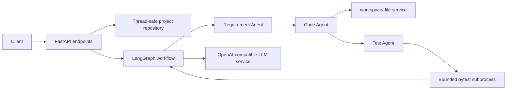

# Multi-Agent Dev Assistant

A Python 3.11+ FastAPI application that turns a software requirement into a
structured plan, generates planned source files, and creates and runs focused
pytest tests. It uses LangGraph to pass typed outputs between the agents.

## Architecture



- `app/agents/requirement_agent.py` creates a deterministic development plan. It
  does not generate code or modify files.
- `app/agents/code_agent.py` requests source text for paths listed by the plan.
- `app/agents/test_agent.py` generates a pytest module and returns test counts,
  errors, and suggestions.
- `app/agents/workflow.py` wires Requirement → Code → Test in LangGraph.
- `app/models.py` defines the Pydantic contracts between agents and API routes.
- `app/services/llm_service.py` contains all OpenAI-compatible API requests.
- `app/services/workspace_file_service.py` validates and writes only plan-listed
  files under `workspace/`.
- `app/services/code_executor.py` invokes pytest with a fixed argument list,
  bounded timeout, no shell, and a reduced environment.
- `app/main.py` exposes the API.

Generated application files and tests are confined to `workspace/`. Existing
files are not silently overwritten: a file must be listed under
`files_to_modify` in the plan to be modified.

## Configure the LLM

The provider adapter targets an OpenAI-compatible chat-completions endpoint.
Copy `.env.example` to `.env` and configure these values (or set them in the
process environment):

| Variable | Default | Purpose |
|---|---|---|
| `LLM_API_KEY` | empty | Provider bearer token; never log or commit the real value. |
| `LLM_MODEL` | empty | Model name sent to the chat-completions API. |
| `LLM_BASE_URL` | empty | OpenAI-compatible API base URL. |
| `LLM_TIMEOUT_SECONDS` | `60` | Provider timeout in seconds (1–300). |
| `LLM_MOCK` | `false` | Use deterministic local placeholder output without network calls. |
| `MAX_RETRIES` | `3` | Code/test retries after the initial workflow attempt. |
| `LOG_LEVEL` | `INFO` | Application logging level. |
| `CORS_ALLOW_ORIGINS` | `http://localhost:3000,http://localhost:5173,http://127.0.0.1:3000,http://127.0.0.1:5173` | Comma-separated allowed browser origins. |
| `WORKSPACE_DIR` | `workspace` | Path for generated code and tests; relative paths resolve from the project root. |

`LLM_API_KEY` can be empty for compatible local endpoints that do not require
authentication. Never commit real credentials; `.env` is ignored by Git.

`LLM_TIMEOUT_SECONDS` accepts values from 1 to 300. Transient timeouts, HTTP 429,
and HTTP 5xx responses are retried up to three total provider attempts with
exponential backoff. `LLM_MOCK=true` enables deterministic placeholder code and
passing generated tests without network access; it is intended for local tests,
not real code generation. `MAX_RETRIES` is the number of code/test retries after
the initial attempt (default: 3).

The Requirement Agent currently uses deterministic local planning rules and
does not require an LLM. Code and test generation require a configured provider
unless mock mode is enabled. The assistant response includes a `status` and an
`attempts` list with each generated file set and its test outcome.

## Run locally (PowerShell)

From the project directory:

```powershell
py -3.11 -m venv .venv
.\.venv\Scripts\Activate.ps1
python -m pip install --upgrade pip
python -m pip install -r requirements.txt
Copy-Item .env.example .env
python -m pytest -v
python -m uvicorn app.main:app --reload --port 8000
```

The API listens on `http://127.0.0.1:8000`. Interactive API documentation is at
`http://127.0.0.1:8000/docs`.

Set `LLM_API_KEY`, `LLM_MODEL`, and `LLM_BASE_URL` in `.env` before making
provider-backed requests. Set `LLM_MOCK=true` to try the workflow without an
external LLM provider. `CORS_ALLOW_ORIGINS` is a comma-separated list of
frontend origins; `LOG_LEVEL` controls application logging.

## API

- `GET /health` — API liveness check.
- `POST /projects` — queue an asynchronous request. Returns HTTP 202 with the
  project `id` and initial `queued` status.
- `GET /projects/{id}` — retrieve project status (`queued`, `running`,
  `completed`, or `failed`), logs, attempts, and test results.
- `GET /projects/{id}/files` — list existing generated paths confined to
  `workspace/`.
- `POST /api/requirements/plan` — return a plan only; does not generate or write
  code.
- `POST /api/assistant/run` — run the workflow. Set `run_tests` to `false` to
  stop after code generation.

Create an asynchronous project. The request body field is `request`:

```bash
curl -X POST http://127.0.0.1:8000/projects \
  -H "Content-Type: application/json" \
  -d '{"request":"Build a todo API"}'
```

PowerShell (avoids native `curl.exe` JSON quoting issues):

```powershell
$project = Invoke-RestMethod -Method Post `
  -Uri http://127.0.0.1:8000/projects `
  -ContentType "application/json" `
  -Body (@{ request = "Build a todo API" } | ConvertTo-Json)
$project.id
```

Poll the project status and list generated files:

```bash
curl http://127.0.0.1:8000/projects/PROJECT_ID
curl http://127.0.0.1:8000/projects/PROJECT_ID/files
```

```powershell
$projectId = $project.id
Invoke-RestMethod -Uri "http://127.0.0.1:8000/projects/$projectId"
Invoke-RestMethod -Uri "http://127.0.0.1:8000/projects/$projectId/files"
```

Run the backward-compatible synchronous assistant endpoint:

```bash
curl -X POST http://127.0.0.1:8000/api/assistant/run \
  -H "Content-Type: application/json" \
  -d '{"requirement":"Create a Python calculator API with addition and division.","run_tests":true}'
```

```powershell
Invoke-RestMethod -Method Post `
  -Uri http://127.0.0.1:8000/api/assistant/run `
  -ContentType "application/json" `
  -Body (@{
    requirement = "Create a Python calculator API with addition and division."
    run_tests = $true
  } | ConvertTo-Json)
```

The response includes `development_plan`, `code_result`, `status`, `attempts`,
and (when code generation succeeds and `run_tests` is true) `test_result`.

## Run with Docker Compose

Create `.env` from `.env.example` and configure the provider or set
`LLM_MOCK=true`. The compose service reads environment values from `.env` and
persists generated files in the `workspace_data` volume; `.env` is excluded
from the image build context and is never copied into the image.

```powershell
Copy-Item .env.example .env
docker compose up --build
```

The container runs as a non-root user on port 8000 and exposes `/health` as its
health check. Stop it with `Ctrl+C`; remove the container with
`docker compose down`. Generated workspace data remains in the named volume.

## Known limitations and security notes

The test runner uses an explicit pytest invocation, never a user-supplied shell
command, limits runtime, restricts test paths to `workspace/`, and omits
application secrets from the child environment. Generated code and generated
tests execute in a subprocess with a timeout, but the subprocess is **not** a
full OS-level sandbox and network access is not blocked. Only use trusted LLM
providers, run generated code in an appropriately isolated environment, and do
not expose this development API publicly without adding authentication and a
real sandbox.
